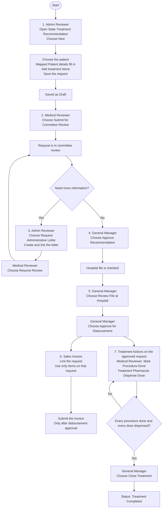

# State Treatment

State Treatment helps a healthcare team manage requests for state-funded treatment in one place. Staff record a request, follow it through review and approval, print its form, record procedures and medicine doses on approved requests, and link a Sales Invoice to the approved treatment items.

**It supports the administrative process; it does not recommend or decide medical treatment.**

## Who Does What

- **Administrative Reviewer:** Creates the request for an existing patient. The patient details configured in Settings fill in automatically. Records administrative letters when more information is needed.
- **Medical Reviewer:** Reviews requests at the committee stage and resumes review after requested information is recorded. On an approved request, marks each procedure as done.
- **General Manager:** Makes the recommendation decision and moves approved requests through hospital-file review and disbursement approval. Closes the treatment with **Close Treatment** once every procedure is done and every dose is dispensed.
- **Treatment Pharmacist:** On an approved request, dispenses scheduled medicine doses. The system records the user and time.

In this release, hospital-file review is a step completed by the General Manager; there is no separate Hospital role. **Treatment Completed** is set only by the General Manager's **Close Treatment** action, and only once the treatment is fully done.

## Using the System

Before you begin, make sure the patient already exists in Healthcare, the administrator has loaded the treatment catalog and prices, and the **Patient Field Map** in State Treatment Settings points to Patient fields that exist on the site. Sign in with the role assigned to you. You will work with a **State Treatment Recommendation** record, which follows the approval workflow below.

### Workflow Graph



The graph shows the approval steps. Treatment on an approved request uses the **Treatment Actions** menu described below.

### Procedures and Medicine Doses

For each medicine protocol item, set its **First Dose Date** on that request row. Medicine name, number of doses and interval come from the protocol catalog. When the request reaches **Approved for Disbursement**, the app creates one dose row per prescribed dose, with dates calculated from the first dose date and the protocol interval. The medical team can adjust scheduled dates. A change to a medicine's regimen or start date after approval creates a new numbered schedule version. Earlier doses and dispensing records remain.

Schedules are linked to the individual request-item row, so duplicate medicines stay distinct. Re-saving an unchanged approved request does not duplicate its schedule.

On an approved request, use **Treatment Actions** in the form menu:

- **Dispense Dose** (Treatment Pharmacist): choose one undispensed dose from the current schedule. Each action dispenses one dose. The system records the user and time. A dispensed dose cannot be reverted.
- **Mark Procedure Done** (Medical Reviewer): choose a procedure that has not been performed. Each procedure is marked once. The system records the user and time. It cannot be reverted. Procedures do not create dose rows. Multi-session procedures, such as radiation given over several sessions, are not modelled yet.
- **Close Treatment** (General Manager): available only when every procedure is done and every dose is dispensed. It changes the status to **Treatment Completed**.

The actions ask for confirmation, and the form must be saved before any of them runs.

The **Treatment Summary** lists, for each medicine, how many doses are dispensed and how many remain. For each procedure, it shows whether the procedure has been performed.

When every procedure is done and every dose in the current schedule is dispensed, the General Manager can use **Close Treatment**. Using it changes the request's status to **Treatment Completed**.

## For System Administrators

### Prerequisites

**Yes, Healthcare is required.** Before installing State Treatment, install these platform apps on the same Frappe site, in this order. These are the versions this app has been tested with on Frappe v14:

1. Frappe Framework **v14.67.0** (`version-14`)
2. ERPNext **v14.65.0** (`version-14`)
3. Healthcare **v14.1.3** (`version-14`)

State Treatment is the app documented in this repository, not a prerequisite. Install it after the three platform apps using the command below.

Before staff begin processing requests, make sure that:

- Healthcare is installed and contains the patients who will be selected on requests. The **Patient** record is required for each request.
- The relevant **Healthcare Service Unit** records exist for facilities selected on requests and administrative letters.
- Protocol Items and their State-funded EGP prices have been entered manually, or an authorized catalog has been provisioned securely. Restricted protocol data must not be committed to the public repository.
- Staff have user accounts and have been assigned the appropriate **Admin Reviewer**, **Medical Reviewer**, **General Manager**, or **Treatment Pharmacist** role. A System Manager can administer setup.
- The ERPNext site is configured for the organization, including the company and any standard customer, accounting, and tax details needed to create its Sales Invoices.

The State-funded selling price list must use EGP and each protocol Item must have a price in that list. Protocol Items can be entered manually from Item; no catalog data file is required for manual entry.

### Install

```bash
bench --site [site-name] install-app state_treatment
bench restart
```

Installation adds the default Patient Field Map row (National ID) to State Treatment Settings.

### Upgrade

```bash
bench --site [site-name] migrate
```

On an existing site, this adds the default Patient Field Map row once, if the map is empty. It does not change any row an administrator has already set.

Version 0.3.0 changes how a treatment is completed. The status is no longer set automatically when the last dose is dispensed. The General Manager uses **Close Treatment** instead.

### Load the Treatment Catalog

The treatment catalog is restricted data and is intentionally not included in this public repository. Installation does not load it. An authorized administrator must securely provision the JSON file and run the importer on the target site.

```bash
bench --site [site-name] execute state_treatment.patches.v1_0.import_breast_cancer_protocols.execute --kwargs '{"file_path":"/secure/path/breast_cancer_protocols.json"}'
```

The default file path is `state_treatment/data/breast_cancer_protocols.json`; that file is ignored by Git. The catalog and patient records must not be committed to this repository. The administrator should verify the imported protocol items and prices on the site.

### State Treatment Settings

Open **State Treatment Settings**. Only the System Manager role can change it.

- **State-funded Price List:** the EGP price list that holds protocol prices. It is created automatically if it does not exist. Default: نفقة الدولة.
- **Patient Field Map:** copies values from the Patient record into request fields. Each row has:
  - **Form Field:** the request field to fill, for example `national_id`.
  - **Patient Field:** the Patient fieldname that holds the value, for example the custom card-number field `رقم_البطاقة`.

The default row fills `national_id` from `رقم_البطاقة`. Values are copied when a patient is picked. They are also copied on save into any mapped field that is empty, and into every mapped field when the patient changes. Pharmacist saves never copy Patient values.

Rules for the map:

- A Form Field must be a request field that can hold a value. Layout fields, tables, Patient, and Status are rejected.
- If a Patient Field does not exist on the site, the form shows a message and leaves that request field blank. The app never creates Patient fields. Create the field on Patient, or correct its name in the map.
- To fill another request field from the Patient, add a row. No code change is needed.

## Protocol Items

Create protocol records manually from **Item**. Check **Is Protocol**, then choose **Medicine** or **Procedure**. Medicine records require a medicine name, treatment duration, and dose count; the dose interval is calculated as duration divided by dose count. Procedure records do not use duration. The Item name can identify the regimen or procedure. Ministry code, notes, and a serial number are stored on the Item. The internal code is built from ministry code, treatment type, and serial.

Protocol price is stored on the Item and synchronized to the State-funded Price List in EGP, so invoices continue to use ERPNext Item Price. Existing imported catalog Items are exposed as protocol records during migration.

## What the App Includes

- A request record with a tracked approval workflow, and a **Treatment Completed** status set by the General Manager's Close Treatment action.
- State Treatment Settings for the State-funded Price List and the Patient Field Map.
- Versioned medicine dose schedules, created at final approval and linked to their exact request-item row.
- Dispensing and procedure-completion records with user and timestamp, and a Treatment Summary.
- Administrative letters linked to requests.
- A printable request form. Print formats stay in Arabic. Confirm its layout matches the official form on the target site before production use.
- A Sales Invoice check that requires an approved-for-disbursement request and limits invoice items to those on that request.
- Arabic labels, messages and workflow names from `translations/ar.csv`. Field names stay in English.
