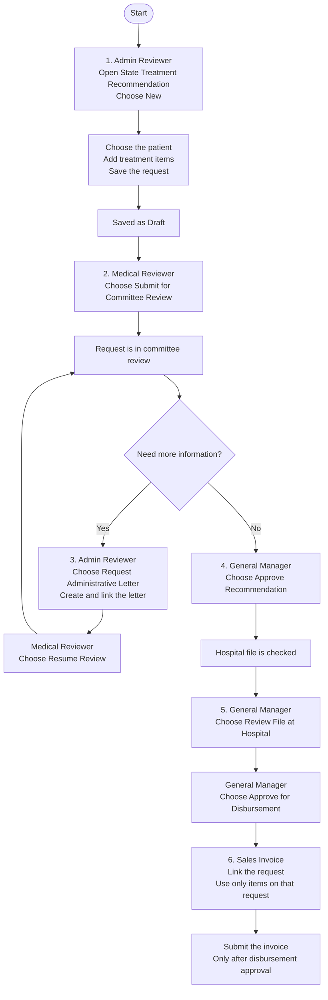

# State Treatment

State Treatment helps a healthcare team manage requests for state-funded treatment in one place. Staff can record a request, follow it through review and approval, print its form, and link a Sales Invoice to the approved treatment items.

**It supports the administrative process; it does not recommend or decide medical treatment.**

## Who Does What

- **Administrative Reviewer:** Creates the request for an existing patient, fills in its details, and records administrative letters when more information is needed.
- **Medical Reviewer:** Reviews requests at the committee stage and resumes review after requested information is recorded.
- **General Manager:** Makes the recommendation decision and moves approved requests through hospital-file review and disbursement approval.
- **Treatment Pharmacist:** Marks scheduled medicine doses as dispensed; the system records the user and timestamp.

In this release, hospital-file review is a step completed by the General Manager; there is no separate Hospital role.

## Using the System

Before you begin, make sure the patient already exists in Healthcare and the system administrator has loaded the treatment catalog and its prices. Sign in with the role assigned to you. You will work with a **State Treatment Recommendation** record, which follows the approval workflow described below.

### Workflow Graph



### Medicine Dose Scheduling and Dispensing

For each medicine protocol item, set its **First Dose Date** on that specific request row. Medicine name, number of doses, and interval are read from the protocol catalog; procedures do not create dose schedules. When the request reaches **Approved for Disbursement**, the app creates one dose row per prescribed dose, with dates calculated from the first dose date and protocol interval. The medical team can adjust scheduled dates.

Schedules are linked to the individual request-item row, so duplicate medicines remain distinct. Re-saving an unchanged approved request does not duplicate its schedule. If the regimen or start date changes after approval, a new numbered schedule version is appended; prior dose and dispensing records remain. The Dose Dispensing Summary reports how many doses are dispensed and remain in the current schedule. Pharmacists can mark doses dispensed; the system records their user and the time automatically. Procedures do not generate doses and can be tracked separately if needed.

## For System Administrators

### Prerequisites

**Yes, Healthcare is required.** Before installing State Treatment, install these platform apps on the same Frappe site, in this order:

1. Frappe Framework **v15.117.0**
2. ERPNext **v15.97.0**
3. Healthcare **v15.2.1**

State Treatment is the app documented in this repository, not a prerequisite. Install it after the three platform apps using the command below.

Before staff begin processing requests, make sure that:

- Healthcare is installed and contains the patients who will be selected on requests. The **Patient** record is required for each request.
- The relevant **Healthcare Service Unit** records exist for facilities selected on requests and administrative letters.
- Protocol Items and their State-funded EGP prices have been entered manually, or an authorized catalog has been provisioned securely. Restricted protocol data must not be committed to the public repository.
- Staff have user accounts and have been assigned the appropriate **Admin Reviewer**, **Medical Reviewer**, **General Manager**, or **Treatment Pharmacist** role. A System Manager can administer setup.
- The ERPNext site is configured for the organization, including the company and any standard customer, accounting, and tax details needed to create its Sales Invoices.

The State-funded selling price list must use EGP and each protocol Item must have a price in that list. Protocol Items can be entered manually from Item; no catalog data file is required for manual entry.

### Install

```bash
bench --site [site-name] install-app state_treatment
bench restart
```

### Load the Treatment Catalog

The treatment catalog is restricted data and is intentionally not included in this public repository. Installation does not load it. An authorized administrator must securely provision the JSON file and run the importer on the target site.

```bash
bench --site [site-name] execute state_treatment.patches.v1_0.import_breast_cancer_protocols.execute --kwargs '{"file_path":"/secure/path/breast_cancer_protocols.json"}'
```

The default file path is `state_treatment/data/breast_cancer_protocols.json`; that file is ignored by Git. The catalog and patient records must not be committed to this repository. The administrator should verify the imported protocol items and prices on the site.

## Protocol Items

Create protocol records manually from **Item**. Check **Is Protocol**, then choose **Medicine** or **Procedure**. Medicine records require a medicine name, treatment duration, and dose count; the dose interval is calculated as duration divided by dose count. Procedure records show the procedure schedule, and duration is not required or used. The Item name can identify the regimen or procedure. Ministry code, notes, and a serial number are stored on the Item. The internal code is built from ministry code, treatment type, and serial.

Protocol price is stored on the Item and synchronized to the **نفقة الدولة** selling price list in EGP so invoices continue to use ERPNext Item Price. Existing imported catalog Items are exposed as protocol records during migration.

## What the App Includes

- A request record with a tracked approval workflow.
- Automatic, versioned medicine dose schedules generated at final approval and linked to their exact request-item row.
- Pharmacist dispensing records with user and timestamp, plus an automatic remaining-dose summary.
- Administrative letters linked to requests.
- A printable request form. Confirm its layout matches the official form on the target site before production use.
- A Sales Invoice check that requires an approved-for-disbursement request and limits invoice items to those on that request.
